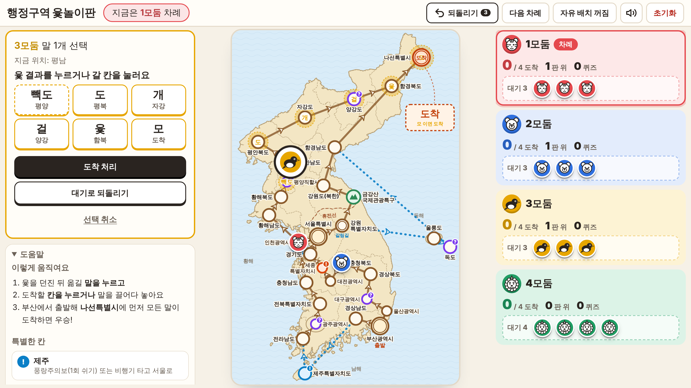

# 행정구역 윷놀이판



5학년 사회 행정구역 복습용 **디지털 윷판** 웹앱입니다.
윷은 교실에서 직접 던지고, 화면에서는 말 이동·업기·잡기·지역 이벤트를 처리합니다.

## 실행해 보기 (내 컴퓨터)

1. [Node.js](https://nodejs.org) LTS 버전을 설치합니다.
2. 이 폴더에서 터미널을 열고 아래를 차례로 입력합니다.

```bash
npm install     # 필요한 도구 내려받기 (처음 한 번)
npm run dev     # 개발용 서버 켜기 → 화면에 나온 주소(http://localhost:5173)를 브라우저로 열기
```

## 배포용 파일 만들기

```bash
npm run build   # dist 폴더에 완성본이 만들어집니다
npm run preview # 완성본 미리 보기
```

## GitHub Pages로 공개하기

1. GitHub에 새 저장소를 만들고 이 폴더를 올립니다. (`node_modules`, `dist`는 `.gitignore`로 제외됨)
2. 저장소 **Settings → Pages → Source** 를 **GitHub Actions** 로 바꿉니다.
3. `main` 브랜치에 올릴 때마다 `.github/workflows/deploy.yml` 이 자동으로 빌드·배포합니다.

## 폴더 구조

```
src/
  App.jsx               화면 전체 조립, 이벤트 흐름 연결
  data/board.js         31개 칸(정식 명칭·좌표·다음 칸·이벤트), 룰렛용 17개 시·도 목록
  data/provinces.js     한반도 1급 행정구역 경계선 (Natural Earth, 퍼블릭 도메인)
  data/teams.js         모둠 색상·동물
  game/reducer.js       게임 규칙(이동, 업기, 잡기, 되돌리기 기록)
  game/useDrag.js       끌어다 놓기
  game/sound.js         Web Audio 효과음
  components/           Board, Scoreboard, TeacherPanel, Roulette, EventModals …
```

칸 위치나 이름을 바꾸려면 `src/data/board.js` 의 숫자와 글자만 고치면 됩니다.

## 저작권·라이선스

- 코드: 직접 작성 (원하는 라이선스를 `LICENSE` 파일로 지정하세요. 예: MIT)
- 시·도 경계: Natural Earth 데이터(퍼블릭 도메인)를 SVG로 변환
- 동물 아바타·헬리콥터·비행기·섬 그림: 모두 코드(SVG)로 직접 그림
- 효과음: Web Audio API로 실시간 합성 (음원 파일 없음)
- 자세한 외부 구성 요소 목록은 `NOTICE.md` 참고
